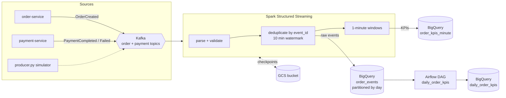

# realtime-event-analytics

[](https://github.com/sameerkhanp119-dot/realtime-event-analytics/actions/workflows/ci.yml)


Turns the order and payment events from [commerce-order-platform](https://github.com/sameerkhanp119-dot/commerce-order-platform)
into business KPIs: **per-minute** numbers from a Spark Structured Streaming job, and a **daily** rollup
built by Airflow with data-quality gates. Everything lands in BigQuery; the GCP resources are Terraform.

## Architecture



### KPIs produced

| Metric | Per minute (stream) | Daily (Airflow) |
|---|:---:|:---:|
| Orders created, gross order value | ✓ | ✓ |
| Payments completed / failed, revenue | ✓ | ✓ |
| Payment success rate | ✓ | ✓ |
| Active customers, average order value | | ✓ |

## Design decisions

| Problem | Approach |
|---|---|
| **Kafka is at-least-once** | Every event carries an `eventId`. The stream drops re-deliveries with `dropDuplicatesWithinWatermark`, and the daily rollup de-duplicates again with `ROW_NUMBER()` so sink retries can't inflate numbers. |
| **Late and out-of-order events** | Windows are in event time with a 10-minute watermark; events later than that are excluded from the minute KPIs but still land in the raw table and the daily rollup. |
| **Bad data** | Records with unknown event types, malformed JSON or missing ids are dropped at parse time instead of failing the stream. |
| **Re-runs and backfills** | The daily job is a `MERGE` keyed by date, so re-running any day replaces that day's row instead of duplicating it. |
| **Trusting the output** | Airflow gates the rollup: no source data → fail before building; after building, assert exactly one row and a success rate within [0, 1]; alert if the stream's duplicate rate exceeds 5%. |
| **Query cost** | Raw events are partitioned by event day (the rollup scans one partition) and clustered by `event_type, order_id`. Partitions expire after a configurable retention. |
| **Testability** | All transformations are pure functions on DataFrames, so the same code runs on the Kafka stream in production and on small in-memory DataFrames in unit tests. |

## Project layout

```
src/rta/events.py          event contracts + realistic order/payment generator
src/rta/producer.py        publishes simulated events to Kafka
src/rta/transforms.py      parse, deduplicate, windowed KPIs (pure PySpark)
src/rta/streaming_job.py   Kafka -> transforms -> console | parquet | BigQuery
airflow/dags/              daily_order_kpis DAG + SQL (MERGE rollup, quality checks)
terraform/                 BigQuery dataset/tables, GCS bucket, least-privilege service account
tests/                     PySpark unit tests, generator tests, SQL template and DAG integrity tests
```

## Run it locally

Requires Docker.

```bash
docker compose up --build
```

The producer publishes about 20 orders per second (2% re-delivered on purpose, orders over $1,000 declined).
After a minute, the `spark-streaming` container prints micro-batches of raw events and per-minute KPIs (example shape):

```
+-------------------+-------------------+--------------+-----------------+------------------+---------------+--------+--------------------+
|window_start       |window_end         |orders_created|gross_order_value|payments_completed|payments_failed|revenue |payment_success_rate|
+-------------------+-------------------+--------------+-----------------+------------------+---------------+--------+--------------------+
|2026-10-15 18:00:00|2026-10-15 18:01:00|1187          |899412.37        |788               |397            |389506.1|0.665               |
```

Write Parquet instead: `SINK=parquet docker compose up` (output under `./data/output`).

## Deploy to GCP

```bash
cd terraform
terraform init
terraform apply -var project_id=<your-project>
```

Then run the streaming job on Dataproc (or any Spark 3.5 cluster) with the Kafka and BigQuery connectors:

```bash
gcloud dataproc jobs submit pyspark src/rta/streaming_job.py \
  --cluster=<cluster> --region=us-central1 \
  --py-files=src/rta/__init__.py,src/rta/events.py,src/rta/transforms.py \
  --properties=spark.jars.packages=org.apache.spark:spark-sql-kafka-0-10_2.12:3.5.3,com.google.cloud.spark:spark-bigquery-with-dependencies_2.12:0.41.0 \
  -- # env: SINK=bigquery BQ_PROJECT=<project> BQ_DATASET=commerce_analytics CHECKPOINT_PATH=gs://<bucket>/checkpoints
```

Deploy `airflow/dags/` to Cloud Composer and set `RTA_GCP_PROJECT` and `RTA_BQ_DATASET`.

## Tests

```bash
pip install -r requirements-dev.txt
pytest
```

CI runs three jobs: PySpark unit tests on Java 17, Airflow DAG integrity with Airflow 2.10 and the Google provider, and `terraform fmt` + `validate`.

## Roadmap

- Schema Registry with Avro contracts shared with the Java services
- Multi-currency KPIs with FX conversion at event time
- Dead-letter topic for rejected records with a reprocessing DAG
- Looker Studio dashboard on `daily_order_kpis`

## License

MIT
